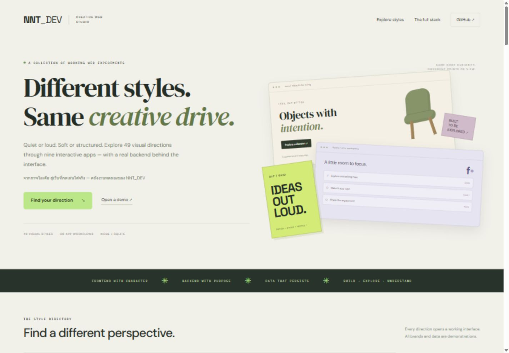

# NNT Web Style Lab

เว็บพอร์ตโฟลิโอสำหรับฝึก **Frontend + Backend + Data visualization + Applied AI** ของ [nnt2525](https://github.com/nnt2525) สำรวจงานออกแบบ 49 สไตล์ผ่านแอป 9 ประเภท พร้อม HTTP API และฐานข้อมูล SQLite ที่บันทึกข้อมูลได้จริงเมื่อรัน Node server

**49 visual presets · 9 app workflows · Node.js 24+ · SQLite · Vanilla JavaScript**



สไตล์ทั้ง 49 ใช้โครงหน้าและความสามารถร่วมกันตามประเภทแอป แล้วเปลี่ยนแบรนด์ สี ตัวอักษร พื้นผิว กรอบ และองค์ประกอบตกแต่ง จึงเป็นห้องทดลองเปรียบเทียบดีไซน์ **ไม่ใช่ระบบธุรกิจอิสระ 49 ระบบ** ชื่อแนวออกแบบบางชื่อทับซ้อนกันได้ และถูกตีความเพื่อการเรียนรู้ในโปรเจกต์นี้

- [GitHub repository](https://github.com/nnt2525/nnt-web-style-lab)
- Expected Pages preview: [nnt2525.github.io/nnt-web-style-lab](https://nnt2525.github.io/nnt-web-style-lab/) — deployment verification pending.
- [Architecture](docs/ARCHITECTURE.md) · [HTTP API](docs/API.md) · [คู่มือ 49 สไตล์](docs/STYLE_GUIDE_TH.md)
- [Verification notes](docs/VERIFICATION.md)

## Run the full stack

Install **Node.js 24 or newer**, clone this repository, then run from its root:

```sh
git clone https://github.com/nnt2525/nnt-web-style-lab.git
cd nnt-web-style-lab
npm run build
npm run dev
```

Open **http://127.0.0.1:4180**. The same server serves the frontend and `/api`; SQLite creates `data/workspaces.sqlite` automatically. No `npm install`, third-party runtime packages, database service, AI API key, or model download is required. Node may print an experimental SQLite warning depending on the installed release.

If Node is available but `npm` is missing from `PATH`, use the equivalent commands:

```sh
node scripts/build.mjs
node server/index.mjs
```

If PowerShell blocks `npm.ps1`, use `npm.cmd` for the same scripts. Stop the server with `Ctrl+C`. To check API behavior in another terminal:

```sh
npm test
# Equivalent without npm:
node --test tests/*.test.mjs
```

## What works

| Workflow | Example style | Frontend and backend behavior |
| --- | --- | --- |
| Shop & orders | Minimalist / Japandi | Filter fictional products, build a cart, save an order, and read order history. The server calculates prices and checks per-workspace stock. No payment is taken. |
| Bookings | Organic & Hand-Drawn / Split-Screen | Select a service, valid date, time, and guest count. Save or cancel a booking; the server checks slot capacity. No real venue is contacted. |
| Events & tickets | Neubrutalism / Cyberpunk | Filter fictional events and reserve demo passes. The server calculates totals and checks ticket capacity; no usable ticket is issued. |
| Task workspace | Soft UI / Bento Grid | Create tasks, move them between three statuses, search, delete, and restore a deleted task. Data survives a server restart. |
| Journal & bookmarks | Editorial / Neo-Noir | Read complete sample articles, filter categories, and save/remove bookmarks in a personal reading list. |
| Courses & quizzes | Claymorphism / Pixel Art | Read lessons, record completion, and submit a quiz for server scoring. Answer keys stay out of public API responses and static fixtures. |
| Creative studio | Generative Art / Spatial UI | Change seed, color, density, scene, and motion; rotate a CSS 3D object. Save/load/delete presets and store an example project inquiry in SQLite. Inquiries are not emailed. |
| Data & ledger | Industrial Grid / Technical Blueprint | Create income/expense entries, inspect server totals, filter category charts and a table, export filtered CSV, and delete/restore entries. Money is stored as integer satang. |
| AI text workbench | Dark Futuristic / AI-Native | Send Thai/English support text to a local classifier through the API, inspect class scores and unfamiliar-pattern coverage, and read saved prediction history. |

The gallery supports searching and filtering styles. Each app has its own layout and workflow module; related styles share that module. Illustrations, visual effects, canvas scenes, and the CSS 3D object are drawn in code. The studio is not a 3D modeling engine.

## Local server versus GitHub Pages

| Capability | Node server | GitHub Pages preview |
| --- | --- | --- |
| Browse 49 styles and public sample content | Yes | Yes |
| Filter products, events, stories, and gallery cards | Yes | Yes |
| Adjust a generative scene | Yes | Yes, without saved presets |
| Save orders, bookings, tasks, bookmarks, progress, presets, inquiries, or ledger entries | SQLite | Unavailable; explicit backend message |
| Server-score quizzes or run the text classifier | Yes | Unavailable |
| Keep workflow history after restart | Yes, with the same database and valid workspace cookie | No backend storage |

GitHub Pages hosts `public/` as a **read-only preview**. It cannot run Node or SQLite. When `/api/bootstrap` is unavailable, the frontend loads generated public catalog fixtures and explains the preview mode. It never reports a successful database write for an unavailable API. New workspace histories and the ledger start empty; enter demo data locally to exercise them.

## How data is separated

The first bootstrap request creates an anonymous browser workspace. A random `HttpOnly`, `SameSite=Lax` cookie identifies it for **seven days**; this is not registration, login, or a recoverable user account. Records belong to the workspace and a style slug. Opening another style shows that style's records. Stock and booking/ticket capacity are shared across styles **within the workspace**, while separate visitors receive independent demo inventory.

The same valid browser cookie and database file recover records after a server restart. Clearing the cookie starts another workspace. Expired workspaces and their records are cleaned up when a later bootstrap creates a workspace. Use fictional inputs; there is no account recovery or cross-device sync.

## The AI model

This repo reuses the support classifier from [applied-ai-web-lab](https://github.com/nnt2525/applied-ai-web-lab). It runs **character 2–4-gram Multinomial Naive Bayes** locally in `server/inference.mjs`, using checked-in parameters from `server/support-model.json`.

- Trained on **96 hand-authored educational synthetic Thai/English messages**.
- Four classes: `account`, `billing`, `delivery`, and `technical`.
- The API stores actual inference results and flags low coverage or weak leading scores for review.
- Scores are **uncalibrated model scores**, not the probability of correctness. A high score can still be wrong.

This is a small supervised classifier, not an LLM, chatbot, external AI service, or autonomous agent. The “AI-Native & Agentic UX” preset is a visual theme name. This repo does not claim new model training or real-world accuracy; realistic labeled data and independent evaluation are needed before operational use.

## Configuration and Docker

Defaults work without an environment file. See [`.env.example`](.env.example). To use a copied `.env` file, run:

```sh
node --env-file=.env server/index.mjs
```

| Variable | Default | Purpose |
| --- | --- | --- |
| `HOST` | `127.0.0.1` | Listen interface; keep loopback for local use |
| `PORT` | `4180` | HTTP port |
| `DB_PATH` | `data/workspaces.sqlite` | SQLite file; relative paths resolve from the working directory |
| `PUBLIC_ORIGIN` | unset | Exact external HTTP(S) origin when using a reverse proxy |

Docker configuration is provided; **the container build and Compose runtime have not been verified in this environment**:

```sh
docker compose up --build
docker compose down
```

Compose exposes `127.0.0.1:4180` and mounts the named volume `lab-data` at `/data`. Ordinary `docker compose down` keeps that volume; `docker compose down -v` deletes its saved demo database. Keep and back up the volume if the records matter.

Behind a TLS-terminating reverse proxy, add the exact public origin to the Compose service environment, for example `PUBLIC_ORIGIN: https://demo.example.com`. Keep Node's internal listener private. The server checks browser write origins against this value and marks the workspace cookie `Secure` for HTTPS origins. It does not trust `X-Forwarded-Host` or `X-Forwarded-Proto`. An origin contains a scheme, hostname, and optional port, with no path, credentials, query, or fragment. See [API configuration details](docs/API.md).

## Verification and limits

HTTP integration tests cover all nine workflows, database persistence after restart, workspace ownership, CSRF/origin checks, server-owned prices, capacity constraints, invalid input, session expiry, and confinement of served files to `public/`. Run them locally using the commands above; Docker verification is separate.

The server uses bound SQL parameters, validates JSON fields and ranges, limits request bodies to 32 KB, requires CSRF tokens for writes, and sends security headers. These controls demonstrate useful engineering practices; this remains an educational prototype. It has no production identity system, authorization roles, request rate limiting, abuse controls, operational monitoring, backup automation, or payment/email integrations. Public production use needs those decisions, HTTPS, and an appropriate security review.

Frontend code is **HTML, CSS, and browser JavaScript modules**, without React or another frontend framework. This makes the request/data flow easy to inspect. A future React or Next.js version would be a separate implementation choice, not a feature claimed by this repo.

## Project map

```text
public/
  index.html                  Searchable style gallery
  assets/styles.js            49 presets; source of truth
  assets/apps/                Nine independent workflow modules and their CSS
  assets/api.js               API connection, CSRF, and read-only preview handling
  demos/<style>/index.html    Generated entry routes
server/
  index.mjs                   HTTP listener and environment configuration
  app.mjs                     API routing, validation, SQLite, static serving
  catalog.mjs                 Fictional seed catalogs and server quiz keys
  inference.mjs               Local classifier implementation
  support-model.json          Reused educational model parameters
scripts/build.mjs             Generate routes, palettes, and public fixtures
tests/backend.test.mjs        HTTP and SQLite integration tests
docs/                         Architecture, API, and design notes
```

## Make it your portfolio

เริ่มจากเลือกหนึ่ง workflow แล้วตามรอยตั้งแต่ปุ่มบนหน้าเว็บ → JSON request → validation → SQLite → response ทดลองแก้หนึ่งฟีเจอร์และเขียนเหตุผลของการเปลี่ยนไว้ใน commit ก่อนนำไปเล่าในสัมภาษณ์ เพิ่มภาพหรือวิดีโอจากการทดลองที่คุณทำเอง และระบุให้ชัดว่าส่วนใดเป็นข้อมูลจำลอง

งานนี้พัฒนาด้วยความช่วยเหลือจาก AI เจ้าของพอร์ตควรอ่าน ตรวจสอบ ทดสอบ และเข้าใจโค้ดก่อนนำเสนอ ใช้เป็นฐานฝึกตัดสินใจและอธิบายงานของตัวเอง ไม่อ้างว่าฟีเจอร์ที่ยังไม่ได้สร้างหรือผลโมเดลที่ยังไม่ได้วัดมีอยู่แล้ว
