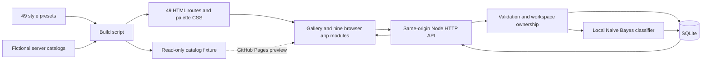
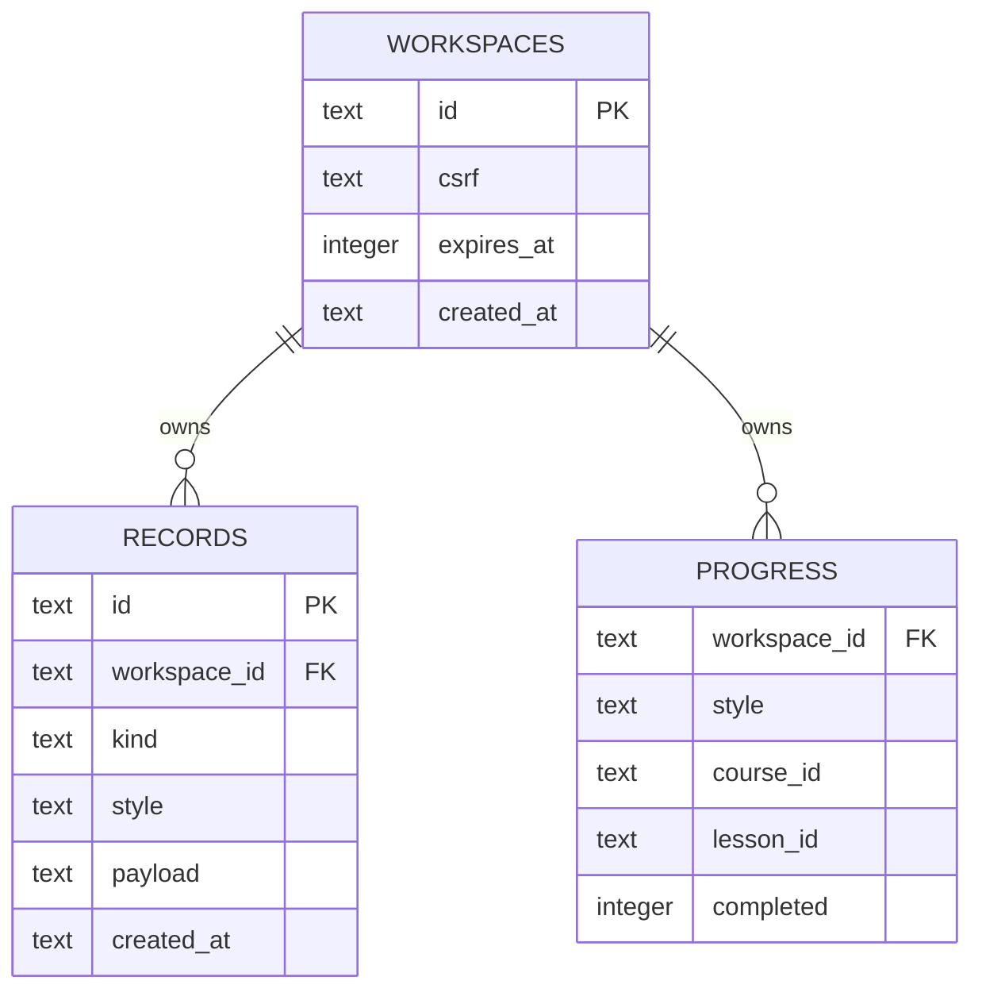

# Architecture

NNT Web Style Lab combines 49 visual presets with **nine app layouts and workflows**. Presets share the implementation for their assigned workflow; they are not 49 separately engineered business platforms. The source of truth is [`public/assets/styles.js`](../public/assets/styles.js).

## Request and rendering flow

`npm run build` creates a small HTML entry point for each style, regenerates palette variables, and serializes public catalog fixtures. Browser-native modules load a shared app shell, the selected style definition, and one workflow module. Each workflow owns its layout and CSS. There is no React runtime, transpiler, bundler, or third-party runtime dependency.

The Node server serves only `public/` and handles `/api/*`. Keeping frontend and API on one origin avoids a separate CORS configuration. `api.js` first calls `/api/bootstrap`, keeps its CSRF token in memory, and attaches that token to workflow writes.

If bootstrap is unavailable, `api.js` switches to a static fixture. Pages visitors can browse content, filter collections, and adjust visual scenes. Writes, server quiz scoring, and AI inference require the Node server and report that requirement. Static preview code does not emulate successful persistence.

## Runtime pieces

| Piece | Responsibility |
| --- | --- |
| `public/assets/styles.js` | Preset ID, slug, visual group, workflow, brand, copy, and three seed colors |
| `public/assets/base.css`, `themes.css`, `palettes.css` | Common primitives, style-specific treatments, generated color variables |
| `public/assets/apps/<app>.js` and `.css` | Nine distinct workflow layouts and browser interactions |
| `public/assets/api.js` | Bootstrap, CSRF request headers, JSON errors, static preview fallback |
| `server/index.mjs` | Host/port configuration and graceful shutdown |
| `server/app.mjs` | HTTP routes, domain validation, sessions, database operations, confined static serving |
| `server/catalog.mjs` | Read-only fictional products/services/events/articles/courses; server quiz answers |
| `server/inference.mjs`, `support-model.json` | Local bilingual educational support classifier |

## SQLite data model

`records.payload` stores validated JSON for orders, bookings, reservations, tasks, bookmarks, presets, inquiries, ledger entries, and classifications. The index on `(workspace_id, kind, style)` supports the collection lookups. Lesson progress uses a separate table with the composite primary key `(workspace_id, style, course_id, lesson_id)`, so repeated completion updates do not create duplicate progress rows.

Foreign keys cascade record deletion when an expired workspace is removed. SQLite runs in WAL mode with a busy timeout. Transactions use `BEGIN IMMEDIATE` for stock/capacity checks and writes, and for duplicate-bookmark prevention. This is a single-process educational design, not a claim of distributed transaction support.

Catalogs live in server source and are not editable through an admin API. Monetary values are integer satang throughout API/storage; the browser formats them as THB. Booking dates are checked against the current calendar date in `Asia/Bangkok`; record timestamps use UTC ISO strings.

## Workspace boundary

Bootstrap creates a random anonymous workspace with a seven-day lifetime. Its `nnt_workspace` cookie is `HttpOnly` and `SameSite=Lax`; the server also requires the workspace's CSRF token on writes and rejects cross-origin browser writes. HTTPS connections or an explicitly configured HTTPS `PUBLIC_ORIGIN` add `Secure` to the cookie.

Every private collection read and record mutation is scoped to workspace ownership. Collections additionally select a style slug, allowing examples to keep separate histories. Stock, service-slot occupancy, and event capacity are checked across styles within that workspace. Separate visitors each get their own fictional inventory rather than competing for global demo stock.

This cookie is a bearer credential for a demo workspace, not a user login. Clearing it loses access to that workspace, and there is no account recovery or device sync. Workspace expiration is fixed, not a perpetual retention guarantee. A later bootstrap that creates a workspace cleans up expired workspaces and cascades their records.

## Example: placing a demo order

1. The browser loads products and collects product IDs, quantities, and a demo alias.
2. `api.js` posts JSON to `/api/orders` with the workspace cookie and CSRF header.
3. The server checks session, origin, body size, exact field names, types, item IDs, and quantity limits. It rejects client-supplied totals or prices.
4. Inside a transaction, the server reads catalog prices, checks earlier workspace orders against stock, computes an integer total, and saves the order.
5. The response returns the persisted order and demo reference. Reloading history reads SQLite, including after a server restart with the same file and unexpired cookie.

No payment, product fulfillment, venue contact, or outgoing email occurs. Inquiries are database records, not messages sent to another person.

## Local model boundary

The AI workflow adapts the existing model and inference code from [`applied-ai-web-lab`](https://github.com/nnt2525/applied-ai-web-lab). Character 2–4-gram Multinomial Naive Bayes classifies support messages into four categories using parameters trained on 96 hand-authored educational synthetic Thai/English examples. Inference does not call a hosted model.

The server stores input and actual output in the workspace. Coverage and the leading uncalibrated class score can trigger abstention. Scores do not establish correctness; results on tiny synthetic data do not establish real-customer performance. “AI-Native & Agentic UX” is a preset name, not an implementation of an LLM or autonomous agent.

## Deployment and verification

- Local development: Node.js 24+, a writable SQLite path, and `npm run build` followed by `npm run dev`.
- GitHub Pages: publish `public/` for static preview; server workflows remain unavailable there.
- Docker: a provided Node 24 image and Compose configuration mount `/data` as the persistent `lab-data` volume. Container execution has not been verified in this environment. Keep the volume to preserve the database.
- Reverse proxy: configure `PUBLIC_ORIGIN` to the exact public HTTP(S) origin, terminate TLS at the proxy, and keep Node private. Forwarded host/protocol headers are not trusted. See [API configuration](API.md).
- Integration tests: use temporary databases, independent cookies, HTTP requests, and a server restart to exercise workflow behavior and persistence. They also cover invalid input, ownership, CSRF/origin rejection, session expiry, trusted prices, capacity, and static-file confinement.

Bound SQL, body-size limits, validation, origin checks, and security headers provide a useful learning baseline. Production authentication, authorization roles, rate limiting, abuse handling, monitoring, backups, and deployment security review remain future work. The synchronous built-in SQLite API and JSON record store are appropriate teaching tradeoffs here; a high-traffic or multi-instance service would need a fresh storage and concurrency design.

See [HTTP API](API.md) for concrete endpoints, payloads, limits, and status codes, and [the Thai style guide](STYLE_GUIDE_TH.md) for the visual catalog.
